# Conductor

Conductor lets one Opus session run a team of cheaper coding agents without losing work. Each agent works in its own git worktree and can land only the files it was given. A person holds every decision that costs money or can't be undone.

I built it for myself, and the code stays private. This repository shows what it does, how it works, and what it did in practice.

https://github.com/user-attachments/assets/f7be7951-f2a3-4db5-bf2c-7c5c009ad2b0

Captions are burned in, and [an `.srt` file](media/conductor-short.srt) sits beside it.

```
1 Python process · 0 runtime dependencies · 7 roles · 6 harnesses · 33 registered models · 1,311 checks
```

## Contents

- [Why I built it](#why-i-built-it)
- [How it works](#how-it-works)
- [One run, start to finish](#one-run-start-to-finish)
- [The rules it enforces](#the-rules-it-enforces)
- [Parts worth a closer look](#parts-worth-a-closer-look)
- [Built on other people's ideas](#built-on-other-peoples-ideas)
- [How it was built](#how-it-was-built)
- [By the numbers](#by-the-numbers)
- [Why the code is not here](#why-the-code-is-not-here)
- [About the video](#about-the-video)

## Why I built it

In the Opus 4.8 and Opus 5 days my usage limits ran out long before my work did. opencode had capable models for free, so I tried handing them work as plain subagents. It kept failing in the same few ways.

- Two agents edited the same file, and one edit vanished at merge. Nobody was told.
- A reviewer's reply stopped mid-word with exit code 0, and the harness graded it a finished review.
- One provider returned a rate limit, and the whole queue waited while other providers sat idle.
- The daemon restarted, the run table lived in memory, and finished work was stranded on branches nobody could find.

None of these is a model problem. A better model fixes none of them. They are control problems, so I built the control layer: real git isolation, declared file scopes, a retry ladder that understands providers, and gates a person holds. With that in place, free and cheap models produced work I could merge, up to eight runs at a time, while Opus spent its limited budget on planning and review.

## How it works

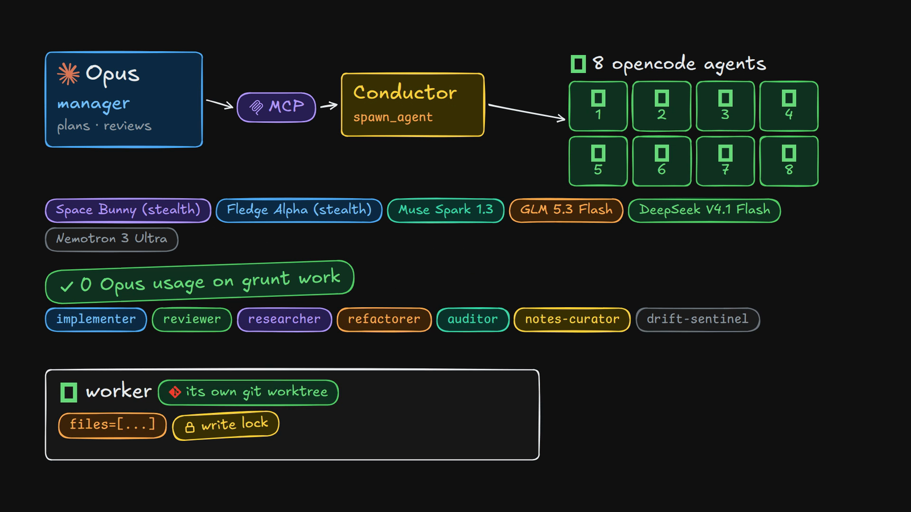

- **The manager** is a Claude Code session on Opus. It plans, splits the work, writes each brief, reads diffs and merges. It talks to Conductor through an MCP server.
- **Conductor** is one Python process (the standard library only) on the host. It schedules runs, holds file claims, packs prompts, classifies how each episode ended, retries or escalates, and serves the dashboard.
- **Workers** are coding agents on cheaper models, mostly free ones. They run through opencode, or Claude Code inside a sandbox. Each run gets its own worktree and branch.
- **The person** holds the gates: a supervised run parks until a human approves it, a paid model is never chosen automatically, and only the human token can approve or reject.

**Why Opus stays light.** Workers do the reading, the tool calls and the token-heavy work on their own models: about 20 billion tokens and 45,000+ tool calls, none of it in Opus's usage or context. The manager reads compact run views and waits on one shell command, `python3 -m conductor.cli wait <run_ids>`, which returns when a run settles.


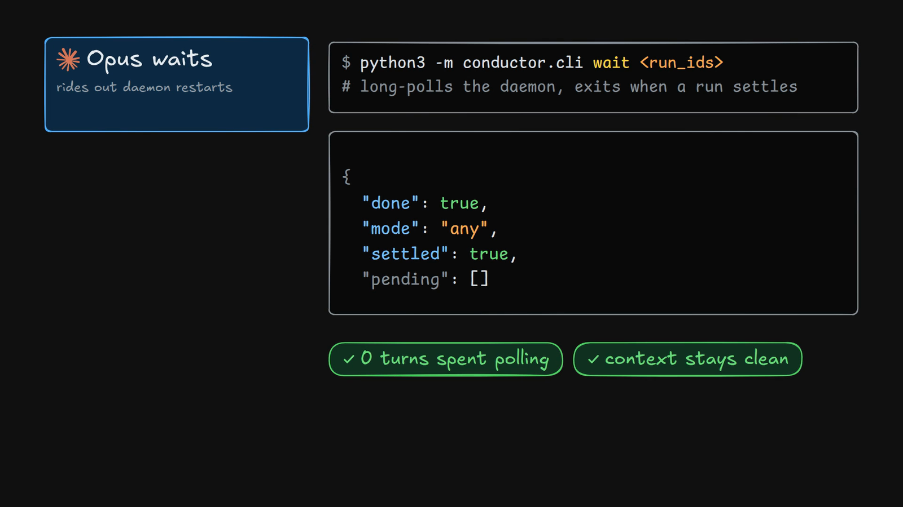

**Seven roles, all data.** A role is a folder with `role.toml` and `prompt.md`; adding one needs no code.

The full flow, from request to merge receipt:

<details>
<summary>Architecture map (click to expand)</summary>

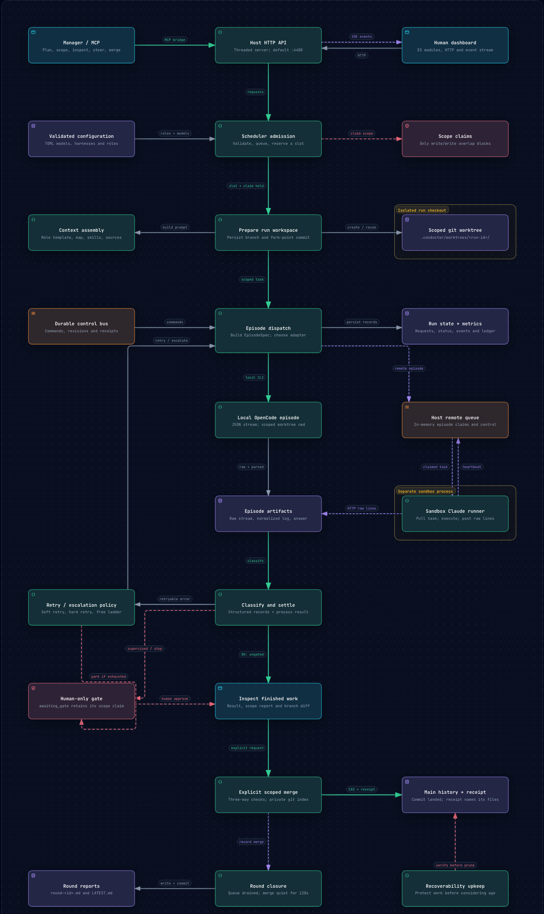

</details>

More in [docs/architecture.md](docs/architecture.md).

## One run, start to finish

These are screens from the real dashboard. Run titles, file paths, the agent's own words and diff lines are blurred because they come from a private project.

<p>
  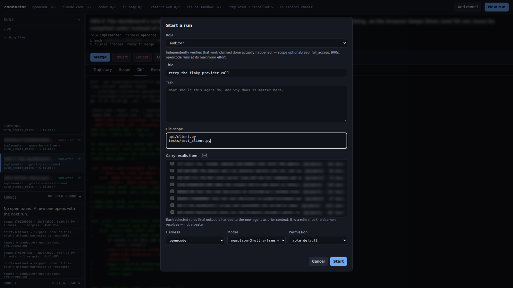
  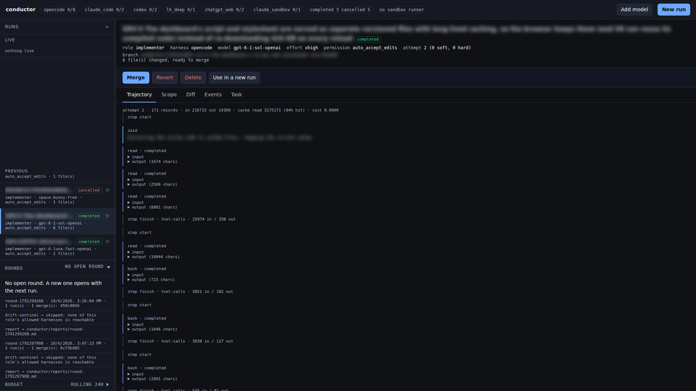
  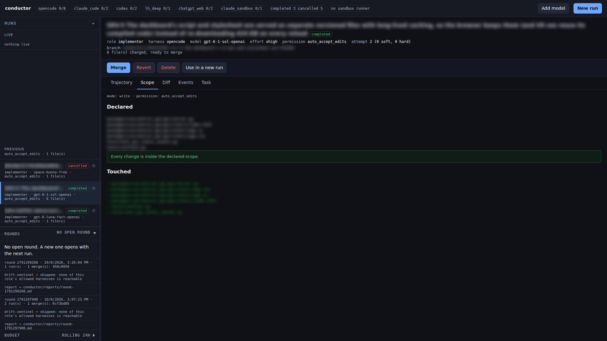
  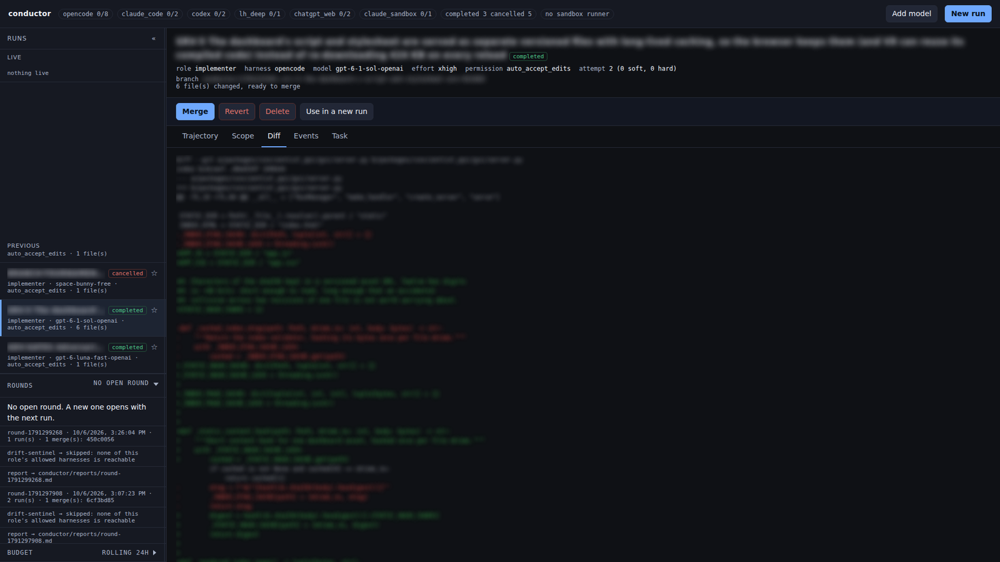
</p>

Starting a run, then a finished run's trajectory, its scope check and its diff.


1. **Spawn.** The manager calls `spawn_agent(role=..., task=..., files=[...])`. The role says which prompt, harness and limits apply. The file list is the run's scope.
2. **Claim.** The scope becomes an exclusive write claim. A second writer on overlapping paths waits. A reader can share the files and is told who else is in them.
3. **Isolate.** The run gets a git worktree and a branch, and records the commit it started from.
4. **Pack the prompt.** Stable parts go first so the provider's prompt cache can reuse them: the role prompt, a skills index, a ranked map of the repository. Then the task-specific parts: a focused slice of the map, the in-scope files, earlier runs' results by reference, and the task.
5. **Run and stream.** The worker's reasoning, tool calls and results stream to disk and to the dashboard as they happen. The manager or I can pause it or send a new instruction mid-run.
6. **Classify.** When the episode ends, Conductor reads the structure of the trajectory, not the exit code. A stream that stops on an unanswered tool call is `TRUNCATED` and retryable.
7. **Retry or escalate.** The ladder decides: nudge the same session, move to another model, or stop and ask.
8. **Park.** Finished work waits on its branch. Nothing merges by itself.
9. **Merge.** The manager reads the diff and the scope report, then merges. The merge takes the declared files and nothing else. If main changed those files since the run began, it merges three ways or refuses and names the commits. A receipt records what landed.
10. **Close the round.** When the queue drains and merges go quiet, Conductor writes a round report, commits it, and starts two reviews: a notes curator and a drift sentinel.

## The rules it enforces

Each rule exists because breaking it caused a real failure, and a test holds each one.

| Rule | What it prevents |
|---|---|
| Write scopes are exclusive; read scopes are not | Two writers silently losing an edit at merge |
| Nothing auto-merges | A worker's stray changes landing unseen |
| A merge takes declared paths only, three-way or refused | Out-of-scope edits riding along, or main's newer work being overwritten |
| The manager cannot clear a human's gate | An agent approving its own delegate's work |
| A stream that stops is not an answer | Truncated reviews graded as complete |
| A run outlives the daemon that started it | Finished work stranded after a restart |
| Never delete the only way back | Housekeeping removing an unmerged branch |
| Never report an action you did not take | Instructions receipted as delivered when they were only queued |
| The run lock never covers I/O | The dashboard freezing behind a git call |

Details and the incidents behind them: [docs/design-decisions.md](docs/design-decisions.md).

## Parts worth a closer look

### An escalation ladder that understands rate limits

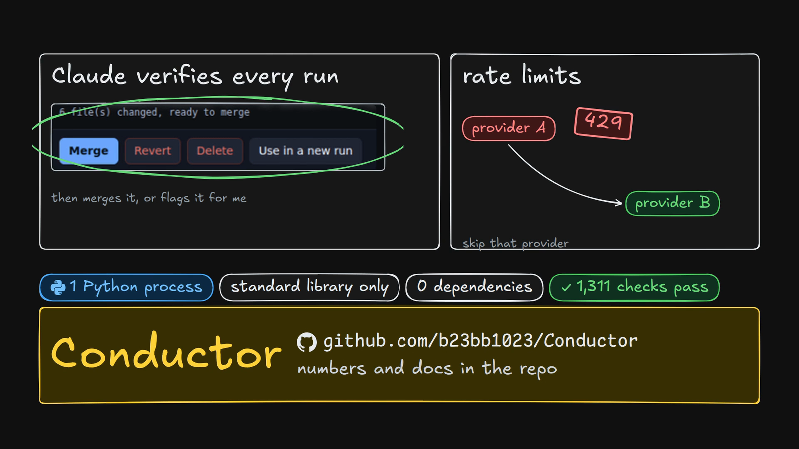

The ladder is data in a TOML file, and each model carries its own retry counts, stall timeout and daily session cap. A rate limit belongs to the account, not the model. So when one model is limited, Conductor skips every model on that provider, instead of burning a session to prove the second one shares the limit. A paid model is never chosen automatically. The local model sits last, because it is the one rung with no cap.

### Truncation is read from structure

A read-only role leaves no diff, so its final message is the only evidence it did the job. Conductor flags two facts in the normalised trajectory: a final step with no clean stop reason, or a tool call with no result. Both are structural, so a worker that merely reads a file containing "429" cannot trip the rate-limit detector either.

### Live steering

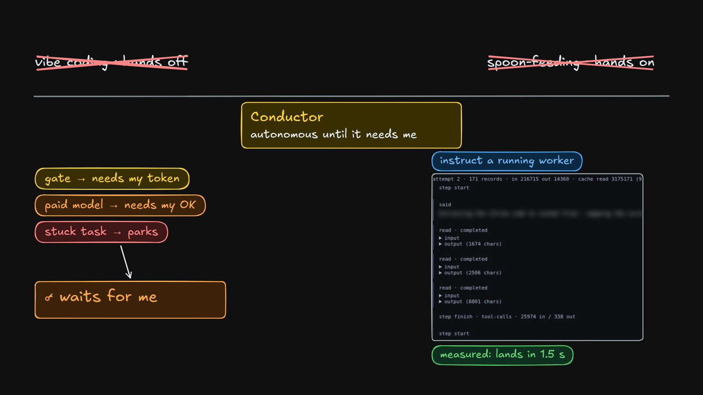

A headless Claude Code worker accepts more user messages on stdin while it works. Measured: a message sent 8.0 seconds into a four-step plan was picked up at 9.5 seconds, the moment the running tool returned, and the agent changed course. The delivery receipt is the agent's echo of the message, not a successful pipe write. For opencode workers, Conductor stops the episode at the end of its current step and resumes the same session with only the new instruction, so no new session is charged.

### Cache-first prompts

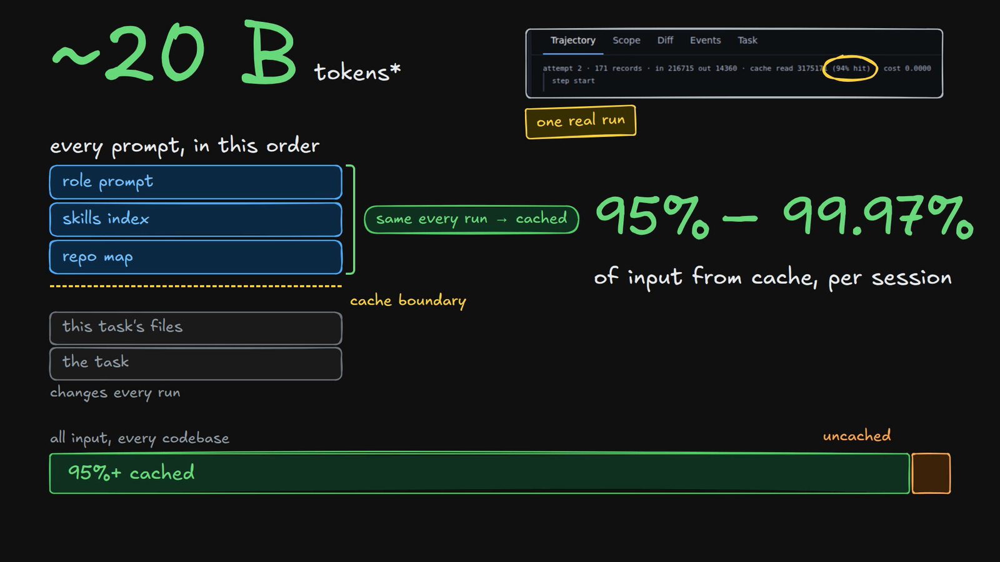

Prompt caches reuse the longest shared prefix, so block order is a cost decision. Conductor keeps a global repository map in the stable prefix and a task-focused slice in the volatile tail. Across about 20 billion tokens of worker traffic, 95% to 99.97% of each session's input came from cache (median 96.7%, best 99.97%).

### A repository map that degrades instead of going silent

The map is a symbol skeleton built with Python's `ast`, ranked by PageRank over the import graph and biased toward the task's files. When the budget runs out, files the task declared drop to name-only lines rather than vanish: a model can open a shallow entry, but not a missing one. A disk cache for the map was designed, measured at 0.7 seconds saved per daemon start, and deliberately not built.

### Gates the manager cannot clear

The MCP server gives the manager everything reversible: spawn, watch, steer, diff, merge, revert. Approve and reject are absent on purpose, and the daemon enforces it. Those calls need the human token, which lives outside the repository. The shared agent token gets a 403.

### Rounds and a drift sentinel

A round report is the durable memory: it survives the manager's context window. The drift sentinel compares the round against a short `GOAL.md`. It looks for slow architectural erosion, where each fix repairs the current shape and makes it harder to change.

### Smaller things that matter

- **Results by reference.** `spawn_agent(sources=[run_id, ...])` carries up to six earlier runs' output into a labelled block, shared fairly, with every cut stated.
- **Skills as a checked artefact.** One source directory serves Claude Code and opencode. A lock file pins each skill by content hash, so drift is detectable.
- **The sandbox runner.** The daemon can't reach into the sandbox, but the sandbox can reach the daemon, so a runner inside it long-polls for episodes, like a CI runner.
- **A hot-reloadable model registry.** The dashboard lists opencode's current free models and appends a TOML block atomically, validated before it replaces the file.
- **Housekeeping that knows work from litter.** Runs are swept after 30 days, but recoverability is checked before age, and a force-deleted branch is bundled to an archive first.
- **A port guard.** On macOS a second listener can silently share a port; `serve` probes first and fails loudly.

## Built on other people's ideas

| Project | What Conductor took |
|---|---|
| [LongHorizon-Harness](https://github.com/AMAP-ML/LongHorizon-Harness) (MIT) | The execution core: CLI adapters, trajectory normalisation, the control bus, provider-error signals, the event stream and process-group handling. Its thesis, "engineer the loop, not the prompt", is the reason Conductor exists. Vendored at a pinned commit. |
| [Traycer](https://traycer.ai) | Scope claims with the read and write distinction, the three permission modes (supervised, auto-accept edits, full access), the error and formatter contract, and the content-hash skill lock |
| [Aider](https://github.com/Aider-AI/aider) | The ranked repository map |
| [Anthropic](https://www.anthropic.com) | Progressive disclosure for skills: the prompt gets an index, not the skills |
| [T3 Code](https://github.com/pingdotgg/t3code) | Dashboard performance lessons, alongside Anthropic's write-up on making claude.ai faster |
| [opencode](https://github.com/anomalyco/opencode) | The worker runtime, and session resume for steering |
| [Claude Code](https://docs.anthropic.com/en/docs/claude-code) | The manager, and the worker inside the sandbox |

The scheduler, claims registry, scope-bounded merge, ladder, gates, rounds, housekeeping and dashboard are Conductor's own. The map of what came from where is in [docs/lineage.md](docs/lineage.md).

## How it was built

| Date | Milestone |
|---|---|
| 7 Aug | A simpler predecessor harness starts delegating work to workers |
| 20 Aug | Conductor's first version lands in one day: the vendored core, roles as data, the episode engine, claims, worktrees, the ladder, the scheduler, the daemon, MCP, the dashboard and the repository map. Live steering and restart-safe run history land that evening. |
| 30 Aug | Every dependency on the predecessor is cut. A model datasheet lets the manager route by measured pace and success. |
| 29 Sep | Merges that never lose work (three-way, dirty-path refusal, receipts, a git lock), waiting instead of polling, steering for opencode workers, one daemon per repository, and the human-only token |
| 5–6 Oct | The dashboard performance pass: a run you left can't repaint the one you're on, typing survives live updates, the run board is cached and hovering preloads a run |

The predecessor kept running until Conductor could replace it, and its workers built parts of Conductor. More in [docs/build-log.md](docs/build-log.md).

## By the numbers

From one project, 20 August to 6 October. I've used it on other codebases too, but these figures come from one.

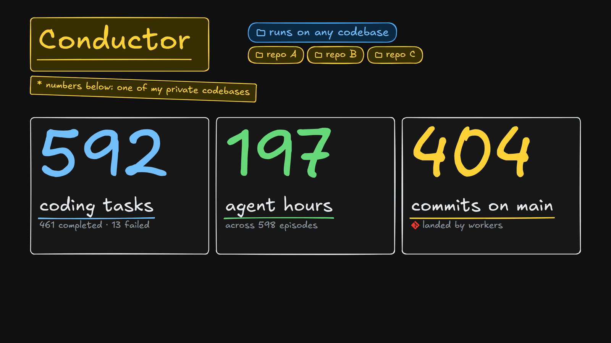

| | |
|---|---|
| Runs | 592 |
| Finished, of runs not cancelled | 97.3% (461 of 474) |
| Commits landed on main by workers | 404 |
| Worker episodes logged | 598 |
| Agent hours logged | 197 |
| Input read from cache, per session | 95% to 99.97% (median 96.7%) |
| Episodes on free-tier models | 83% |
| Rounds closed with a committed report | 92 |
| Agent steps, every codebase (opencode's lifetime stats) | 43,191 |
| Tool calls, every codebase | 45,000+ (estimated from steps and tokens per tool call) |
| Tokens processed by workers, every codebase | about 20 B (estimated: 6.9 B measured, × 2.9 to match OpenRouter's billing) |

A cleanup pruned more than 300 run records from the run store. The run count is rebuilt from what survived it: the round reports in git, the episode ledger and the leftover run branches. How each figure was counted is in [docs/numbers.md](docs/numbers.md).

## Why the code is not here

Conductor was hand-built for my own setup, not for a wider audience, and it carries private material. Its defaults assume my sandbox, my providers and my projects. So the code stays private, and this repository holds the documentation, the diagrams and the video instead.

## About the video

It is made with [HyperFrames](https://github.com/heygen-com/hyperframes): every scene is an HTML page in an Excalidraw style, animated with GSAP and rendered to MP4. The voice is Kokoro, a local text-to-speech model, and each element appears on the word that names it. It is sped up 1.25× after rendering. The music is a CC0 track, "Windows Down" by HoliznaCC0. The dashboard pictures are the real dashboard, with private text blurred. Source, rebuild steps and credits are in [video/](video/).

---

The documentation and media in this repository are under the Apache License 2.0. Conductor's source code is not included.
