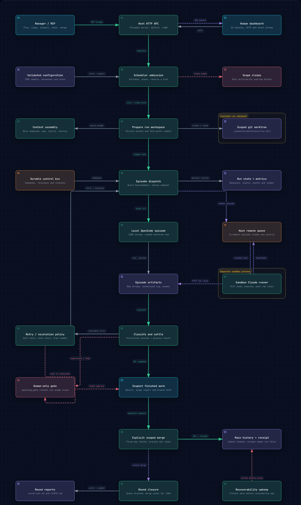
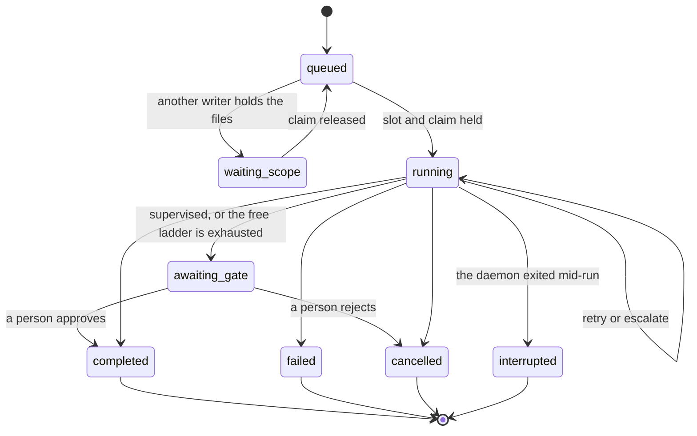

# Architecture

Conductor is one Python process on the host. It needs Python 3.11 or newer and nothing else: no framework, no build step, no database server. Everything below lives in that one process except the workers, which are separate CLI processes it starts and watches.

## The parts

| Part | What it does |
|---|---|
| HTTP API and event stream | The one door. The dashboard, the MCP server and the sandbox runner all talk to it. Server-sent events carry live updates. |
| Scheduler | Admits runs, holds the run table and the slot counts (8 runs at once by default), and drives each run through its states |
| Registry | Harnesses, models, the escalation ladder and roles, all as TOML data. A role is a folder with `role.toml` and `prompt.md`; adding one needs no code. |
| Claims | Exclusive write scopes and shared read scopes, checked at admission |
| Worktrees | One git worktree and one branch per run, with the commit it started from recorded |
| Context packer | Builds each prompt with stable blocks first, so the provider's cache can reuse them |
| Repository map | A ranked symbol skeleton of the repository, built with Python's `ast` |
| Episode engine | Starts the worker CLI, normalises its stream into trajectory records, and classifies how it ended |
| Control bus | Commands to a running worker (pause, instruct, cancel), each with a receipt: queued, delivering, applied |
| Run store | Run records, events, trajectories and the episode ledger on disk, so a restart loses nothing |
| Applier | The scope-bounded merge, built on a private git index, with a receipt per merge |
| Rounds | Close a batch of work, write and commit the report, start the curator and the drift sentinel |
| Housekeeping | Prunes old runs only when nothing unmerged would be lost |
| MCP server | The manager's tools: everything reversible, and no approve or reject |
| Dashboard | ES modules and server-sent events served by the daemon itself; no build step |
| Sandbox runner | Runs inside the sandbox, long-polls the daemon for episodes, executes Claude Code, streams back |

## A run's states

A run parked at a gate keeps its scope claim. It isn't done with those files until a person decides, and freeing them would let another writer in underneath a pending decision.

`interrupted` exists only through a restart. Conductor holds no handle on the old process, so it never "resumes" one: that would run the task twice.

## How an episode ends

Every episode gets one outcome, read from the structured trajectory rather than from text or the exit code.

| Outcome | Meaning | What happens next |
|---|---|---|
| `ok` | Finished and said something | Parks for review |
| `empty` | Finished, said nothing | Retry ladder (below) |
| `truncated` | Ended without a stop reason, or on a tool call with no result | Retry ladder |
| `timeout` | Ran out of wall clock | Retry ladder |
| `provider_error` | The provider failed, not the task | Retry ladder, straight to a fresh session where the model is set up for it |
| `rate_limited` | The account's cap refused the call | Skips every model on that provider. If no free rung is left elsewhere, parks for the person. |
| `not_authenticated` | Needs a login | Parks for the person |
| `failed` | The agent failed the task | Stops: a retry would repeat it |
| `cancelled` | A person or the control bus stopped it | Stops |

The retry ladder, per model: nudge the same session up to the model's soft-retry count, then start fresh sessions up to its hard-retry count, then move to the next model on the ladder. A paid model is never retried automatically; it parks for the person.

## Where things live

Run state lives in `.conductor/` beside the repository: run records, worktrees, event logs, claims, the session budget and the agent token. The run directories are `0700`, because prompts carry source code and trajectories carry tool output. The human token lives outside the repository, in the user's config folder.

One daemon serves one repository. `conductor init --repo <path> --port <n>` prepares another repository with its own config and its own port.
